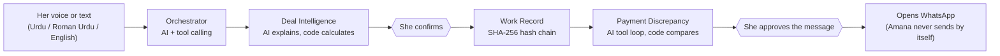

# Amana AI

### *She does the work. Amana works for her.*


**Voice-first AI agents for Pakistan's home-based women workers.** A woman describes an order in Urdu, Roman Urdu or English.
Amana helps her understand the offer, keeps a tamper-evident record of what she agreed to, and later checks whether the payment
she received matches it. She stays in control: nothing is saved or sent without her approval.

**Live demo:** `<PASTE-YOUR-STREAMLIT-LINK-HERE>`

---

## The problem

Many women in Pakistan earn from home through stitching, embroidery, garment work and handicrafts, usually through a contractor or
middleman. Common problems:

- Rates and conditions are unclear.
- There is no proper record of the orders they take.
- It is hard to work out what they really earn after expenses.
- Payments arrive short, or with deductions nobody explained.
- They have no organised proof of what was agreed, delivered and paid.
- The phone is often shared with family, so private records are hard to keep.

> A woman may work for hours or days and have little organised evidence of what she agreed to, what she delivered,
> and what she should have received.

Provincial laws for home-based workers exist, but a law does not mean every worker has an accessible record of her work.

## What Amana does

| | Feature | What happens |
|---|---|---|
| 🧠 | **Deal Intelligence** | Reads her message, asks for what is missing (one question at a time), calculates the expected payment, earnings after expenses and hourly rate, flags unclear or unfavourable terms, and can prepare a counteroffer from *her own* hourly target. |
| 📒 | **Work Record** | After she confirms, saves the agreement as a structured record sealed with a SHA-256 fingerprint, chained to the previous record. Any later change is detected. |
| 💰 | **Payment Discrepancy** | Compares what she received with the agreement, checks whether an advance, an agreed deduction or a partial payment explains the gap, lists what is still unknown, and drafts a polite message for her to review. |
| 🔒 | **Shared-Phone Safe Mode** | 4-digit PIN (stored as a bcrypt hash), auto-lock when idle, lockout after repeated wrong PINs, and notification text that never shows orders or amounts. |



## Why this is an AI *agent* system, not a chatbot

- A real **tool-calling loop**: the model decides which tool to call (`record_order_details`, `calculate_deal`, `get_record`,
  `compare_payment`) and when to ask a follow-up question.
- Agents **share one stored agreement** instead of treating every message as a new conversation.
- **Code does the maths, AI does the understanding.** Every amount comes from tested Python functions in `calc.py`.
  Numbers the model sends back are ignored and replaced by the ones she entered.
- **A safety gate checks every AI sentence.** If AI-written text contains a number that is not in the facts, or an accusing word,
  a fixed polite template is used instead. A payment is never compared against a record whose fingerprint no longer matches.
- **Human approval everywhere.** Saving needs her confirmation; messages need her approval and are only opened in WhatsApp, never sent.
- **Resilient by design.** Providers fall back automatically (Gemini → Groq → NVIDIA). If every provider fails, a rule-based parser
  keeps the app working (the sidebar tells you when it is in offline mode).

### Two views of the same app

- **Worker view:** a calm, phone-style screen with a chat, a big mic, one question at a time and plain-language ticks
  such as "Calculated by code" and "Sealed with a fingerprint".
- **AI view:** a switch in the header opens a judge panel with live counts of AI calls versus code calls, who-does-what,
  the full agent trace, and a tamper toolkit. The worker never needs to see it.

## Tech stack

| Layer | Choice |
|---|---|
| App and UI | Streamlit (mobile-first custom CSS, English and Urdu interface) |
| LLMs | Google Gemini (primary), Groq and NVIDIA (backups), all through one OpenAI-compatible wrapper in `llm.py` |
| Voice | Groq Whisper for speech-to-text, Gemini audio as fallback, optional text-to-speech |
| Maths | Python `Decimal`, fixed and unit-tested rules |
| Validation | Pydantic schemas for every field the model extracts |
| Records | SQLite, canonical JSON, SHA-256 hash chain, versioned (originals are kept) |
| Security | bcrypt PIN, session lock, lockout, masked notifications |

## Quick start

```bash
git clone https://github.com/abdul-rafay19/amana-ai.git
cd amana-ai
python -m venv venv
venv\Scripts\activate            # macOS/Linux: source venv/bin/activate
pip install -r requirements.txt

cp .env.example .env             # Windows: copy .env.example .env
# open .env and add YOUR OWN keys (Gemini and/or Groq)

python check_keys.py             # should end with: OK via gemini
streamlit run app.py
```

No API key? The app still runs in offline mode with a rule-based parser, so you can try the whole flow.

### Configuration

Put keys in `.env` (local) or in Streamlit Cloud under **Settings → Secrets**:

```toml
GEMINI_API_KEY = "..."
GROQ_API_KEY   = "..."
NVIDIA_API_KEY = "..."
# Optional
# PROVIDER_ORDER = "gemini,groq,nvidia"
# GEMINI_MODEL   = "gemini-flash-lite-latest"
# GROQ_MODEL     = "openai/gpt-oss-120b"
```

## Deploy on Streamlit Community Cloud

1. Push this repo to GitHub (never commit `.env`).
2. Open [share.streamlit.io](https://share.streamlit.io), choose the repo, branch `main`, file `app.py`.
3. In **Advanced settings** choose Python 3.12 and paste your keys under **Secrets**.

Storage on Streamlit Cloud resets when the app restarts. For a demo, open **Records → Load sample data**.

## Tests

```bash
python -m pytest tests -q                 # calculations, hashing, tamper detection, PIN, agent loop (no network needed)
python -m tests.eval_extraction           # extraction accuracy on 20 Urdu / Roman Urdu / English inputs
python -m tests.eval_extraction --llm     # the same inputs through the configured AI model
```

The tests cover the worked example (30 dresses × Rs 250, Rs 1,200 materials, 60 hours → Rs 7,500, Rs 6,300, about Rs 105 per hour),
invalid and missing input, partial payments, agreed deductions, tampered records, wrong PINs and lockout, and the safety gate.

## Project structure

```
app.py          Streamlit app: screens, navigation, AI view
ui.py           Design system (CSS, components)         i18n.py     English and Urdu interface text
agents.py       Orchestrator, Deal / Work Record / Payment agents, safety gate
tools.py        Tools the agents can call
calc.py         Deterministic maths and risk rules      schemas.py  Pydantic validation
records.py      Hash-chained records, payments          security.py PIN, lock, masked notifications
llm.py          Gemini / Groq / NVIDIA wrapper + voice  offline.py   Rule-based fallback parser
db.py           SQLite storage                          check_keys.py  Test your API keys
tests/          pytest suite and extraction evaluation
```

## Try the demo (9 steps)

1. Tap an example, or speak or type an order.
2. Answer Amana's questions one at a time (you can skip optional ones).
3. Tap **Show me the numbers**.
4. Try the counteroffer, then **Confirm agreement**.
5. Look at the SHA-256 fingerprint in the saved record.
6. Enter what she received (for example Rs 6,500 against Rs 8,000).
7. Read the payment report and what is still unknown.
8. **Approve** the drafted message (it only opens WhatsApp).
9. **Safe** tab: set a PIN and lock the screen. In **Records**, use *Demo: secretly change the rate* and then *Check all records*.

Turn on **AI view** in the header to watch the agents work.

## Honest limits

- A hash detects changes; it does **not** prove the information was true. Every saved field is tagged *told by the worker* or *calculated*.
- Estimates use only the figures she gives. They are not guaranteed profit or verified market rates.
- A PIN alone does not fully protect a shared phone. Cached data and device security still matter, and notification previews here are simulated.
- Speech recognition can mishear numbers, so typing is always available.
- Amana is a prototype and **not** an official registration system. Any link with labour departments would need their validation first.
- Profile ids in the URL separate visitors but are not real accounts. Do not enter real personal data on a public demo.
- We have not claimed that no similar product exists; competitor research is still to do.
- The offline parser's accuracy on our own test inputs is not a measure of the AI path. Evaluate the AI path on fresh inputs before quoting a number.

## Troubleshooting

| You see | Fix |
|---|---|
| "Offline mode" in the sidebar | No key found. The file must be named exactly `.env` (not `.env.txt`), next to `llm.py`, with lines like `GEMINI_API_KEY=...` |
| Gemini 404 | That model name is not available for your key. Set `GEMINI_MODEL` |
| Gemini 429 | Free-tier limit. Wait a minute, and give each teammate their own key |
| Groq 401 | Use a **Groq** key (`gsk_...` from console.groq.com), not a **Grok** (x.ai) key |
| Groq 404 | The model was retired. Set `GROQ_MODEL` |
| Mic does nothing | Needs `GROQ_API_KEY` or `GEMINI_API_KEY`, and browser microphone permission. Typing always works |

## Roadmap

- Alternative buyers and opportunity matching, and a stronger professional history for each worker.
- Validation with the relevant labour departments before any registration support.
- Real device notifications and a native mobile app.
- Competitor research and testing with real home-based workers.

## Social impact and fit

Women's economic agency (SDG 5), decent work and better documentation (SDG 8), and reduced information barriers for underserved
workers (SDG 10). Success is measured through calculation accuracy, record integrity, prototype reliability, usability, and feedback
from potential users.

---

**AMANA AI: She does the work. Amana works for her.**